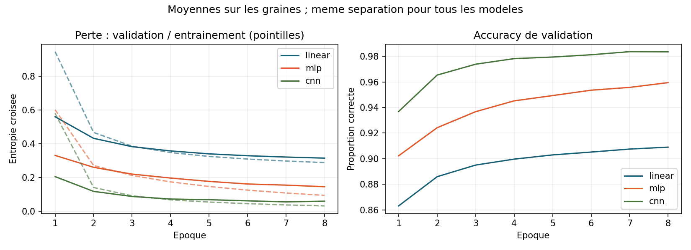
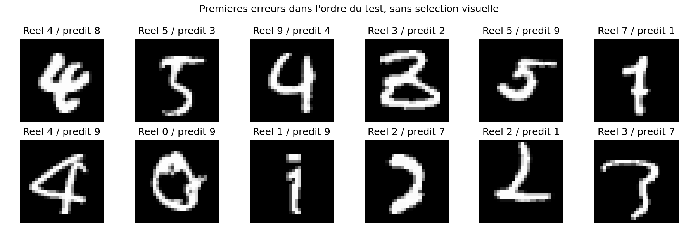

# MNIST : du modele lineaire au CNN

**Que gagne-t-on en tenant compte de la structure spatiale d'une image ?**

Une comparaison experimentale sur Kaggle Digit Recognizer : un classifieur
lineaire softmax, un MLP et un CNN, avec les memes donnees, huit epoques et
trois graines d'entrainement. L'objectif est de comprendre les differences
de generalisation, pas de rechercher un record sur MNIST.



## Resultats mesures

Experience CPU du 15 octobre 2026. Test interne de 8 400 images, tenu a
l'ecart de la selection dans ce protocole. Moyenne et ecart-type sur les
graines 17, 42 et 73 ; l'ecart-type est exprime en points de pourcentage.

| Modele | Parametres | Accuracy test | F1 macro moyen |
| --- | ---: | ---: | ---: |
| Lineaire softmax | 7 850 | 91,83 % +/- 0,09 | 0,9172 |
| MLP, 128 neurones caches | 101 770 | 96,05 % +/- 0,17 | 0,9602 |
| CNN, deux convolutions | 108 618 | 98,32 % +/- 0,06 | 0,9831 |

Le CNN etait deja retenu sur la validation avant l'evaluation finale.
Il depasse le MLP d'environ 2,27 points dans cette experience, pour un nombre
de parametres proche, mais un cout CPU plus eleve. Ce n'est pas une preuve
de superiorite pour toutes les images ou tous les budgets d'optimisation.

[Metriques par execution](results/test-metrics.csv) |
[Synthese](results/test-summary.csv) |
[Protocole et limites](docs/protocol.md)

## Protocole en bref

- 42 000 images etiquetees : 25 200 pour apprendre, 8 400 pour valider, 8 400 pour tester.
- Separation stratifiee fixe ; memes indices pour toutes les architectures et graines.
- Pixels divises par 255 ; Adam, taux 0.001, batch 128, 8 epoques maximum.
- Meilleure epoque selon la perte de validation ; architecture selon l'accuracy moyenne de validation.
- Evaluation du test dans une commande distincte, apres enregistrement de la selection.
- Sources, empreinte des donnees, reglages et versions conserves dans [protocol.json](results/protocol.json).

Les scripts comportent des commentaires en francais. Le CNN et les points
d'entree precedents restent disponibles ; l'etude comparative est ajoutee
dans [src/experiment.py](src/experiment.py).

## Reproduire

Python 3.11 ou plus recent ; experience realisee avec Python 3.12.3.

```bash
python -m venv .venv
source .venv/bin/activate
pip install -r requirements-study.txt
```

Telecharger les donnees depuis [Kaggle Digit Recognizer](https://www.kaggle.com/competitions/digit-recognizer/data).
Placer le fichier etiquete dans `data/train.csv`. Le fichier `data/test.csv`
Kaggle est non etiquete et n'est utile que pour une soumission optionnelle.
Aucun CSV de donnees ni poids de modele n'est versionne.

```bash
python -m src.experiment train --output artifacts/study
python -m src.experiment evaluate --output artifacts/study
python -m unittest discover -s tests
```

Les fichiers produits restent dans `artifacts/study/`. `results/` contient
les tableaux et figures de l'experience presentee. Les versions principales
sont fixees dans `requirements-study.txt` ; le materiel et les dependances
transitives peuvent encore influencer la reproductibilite.

Pour retrouver le pipeline simple anterieur :

```bash
python mnist.py --epochs 3 --cpu
python mnist.py --epochs 5 --submission-out artifacts/submission.csv
```

## Comprendre les erreurs



Ces images sont les douze premieres erreurs du test, pour la premiere graine
prevue, sans selection visuelle. La [matrice de confusion](results/confusion.png)
complete cette inspection. Une erreur peut concerner un trace inhabituel ou
une forme proche d'un autre chiffre ; les images seules n'en prouvent pas la cause.

## Ce que cette etude ne demontre pas

Trois graines ne fournissent pas un intervalle de confiance sur une population.
Le modele lineaire est entraine a budget fixe, pas jusqu'a convergence garantie.
MNIST avait deja servi dans des travaux precedents : ce test interne n'est
pas une validation externe sur des images nouvelles. Aucun score de leaderboard
Kaggle ni aptitude a la production n'est revendique.
